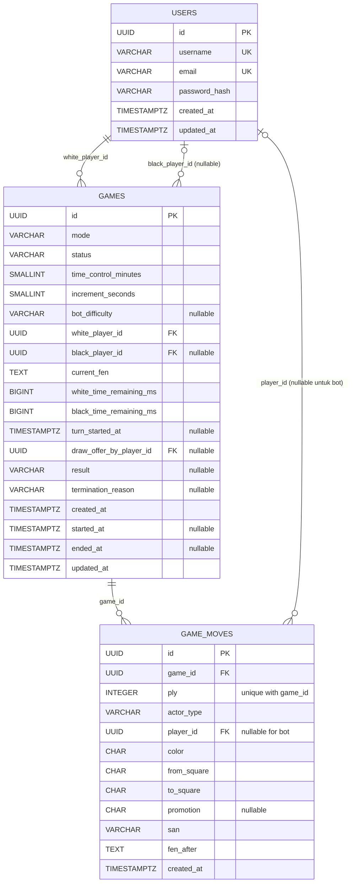

# Rancangan Skema Database MVP

Dokumen ini mendokumentasikan skema PostgreSQL yang digunakan backend dan migration Sequelize. UUID dibuat oleh Sequelize (`DataTypes.UUIDV4`); semua waktu disimpan sebagai `TIMESTAMPTZ`.

## Relasi

```text
users 1 ─── * games (white_player_id)
users 1 ─── * games (black_player_id, nullable saat matchmaking menunggu dan untuk bot)
games 1 ─── * game_moves
users 1 ─── * game_moves (player_id, nullable untuk langkah bot)
```

### Diagram tabel



## `users`

| Kolom | Tipe PostgreSQL | Aturan |
|---|---|---|
| `id` | `UUID` | Primary key; dibuat aplikasi |
| `username` | `VARCHAR(24)` | Wajib, unik |
| `email` | `VARCHAR(254)` | Wajib, unik |
| `password_hash` | `VARCHAR(255)` | Wajib; hash bcrypt saja |
| `created_at` | `TIMESTAMPTZ` | Wajib, default waktu sekarang |
| `updated_at` | `TIMESTAMPTZ` | Wajib, dikelola Sequelize |

Normalisasi username dan email ke huruf kecil sebelum menyimpan dan saat login agar aturan unik tidak membedakan kapitalisasi.

## `games`

| Kolom | Tipe PostgreSQL | Aturan |
|---|---|---|
| `id` | `UUID` | Primary key; dibuat aplikasi |
| `mode` | `VARCHAR(8)` | Wajib; `pvp` atau `bot` |
| `status` | `VARCHAR(16)` | Wajib; `waiting`, `in_progress`, atau `completed` |
| `time_control_minutes` | `SMALLINT` | Wajib; `1`, `3`, `15`, atau `60` |
| `increment_seconds` | `SMALLINT` | Wajib; `0`, `2`, `10`, atau `30` sesuai preset |
| `bot_difficulty` | `VARCHAR(8)` | Nullable; `easy`, `medium`, atau `hard`; hanya untuk mode bot |
| `white_player_id` | `UUID` | Wajib; FK ke `users.id` |
| `black_player_id` | `UUID` | Nullable; FK ke `users.id` |
| `current_fen` | `TEXT` | Wajib; posisi terakhir yang sudah tersimpan |
| `white_time_remaining_ms` | `BIGINT` | Wajib; sisa waktu putih |
| `black_time_remaining_ms` | `BIGINT` | Wajib; sisa waktu hitam |
| `turn_started_at` | `TIMESTAMPTZ` | Nullable saat waiting; awal giliran aktif untuk perhitungan jam server |
| `draw_offer_by_player_id` | `UUID` | Nullable; FK ke `users.id`; pemain yang tawarannya masih menunggu |
| `result` | `VARCHAR(7)` | Nullable; `1-0`, `0-1`, atau `1/2-1/2` |
| `termination_reason` | `VARCHAR(32)` | Nullable; cara game berakhir |
| `created_at` | `TIMESTAMPTZ` | Wajib, default waktu sekarang |
| `started_at` | `TIMESTAMPTZ` | Nullable sampai game dimulai |
| `ended_at` | `TIMESTAMPTZ` | Nullable sampai game selesai |
| `updated_at` | `TIMESTAMPTZ` | Wajib, dikelola Sequelize |

Constraint yang disarankan:

- `mode` hanya menerima `pvp` atau `bot`; `status` hanya menerima nilai yang tercantum di atas.
- Preset waktu: `bullet` = 1 menit + 0 detik, `blitz` = 3 menit + 2 detik, `rapid` = 15 menit + 10 detik, `professional` = 60 menit + 30 detik. Simpan durasi dan increment sebagai menit/detik pada kolom di atas; nilai jam sisa dalam milidetik.
- Pasangan durasi dan increment harus cocok persis: `(1,0)`, `(3,2)`, `(15,10)`, atau `(60,30)`; nilai silang tidak valid.
- `bot_difficulty` wajib untuk mode bot dan harus kosong untuk PvP; nilai yang diterima `easy`, `medium`, atau `hard`. Pemetaan ke parameter Stockfish dilakukan di server, bukan diterima sebagai parameter engine mentah dari klien.
- Untuk PvP, `black_player_id` kosong saat `waiting` dan terisi saat `in_progress` atau `completed`. Baris `waiting` adalah antrean matchmaking, bukan room publik untuk dipilih.
- Partial unique index pada `games.white_player_id` dengan kondisi `mode = 'pvp' AND status = 'waiting'` membatasi satu antrean aktif per pemain.
- Aturan MVP: satu pemain hanya boleh memiliki satu game PvP aktif, yaitu satu antrean `waiting` atau pertandingan `in_progress`. Aturan lintas kolom ini dijaga service dalam transaksi menggunakan advisory transaction lock global yang sama untuk semua preset; request ulang mengembalikan game aktif yang sama. Setelah game selesai, pemain dapat masuk antrean baru.
- Untuk mode bot, `black_player_id` selalu kosong; identitas lawan berasal dari `mode = 'bot'`.
- Pemain putih dan hitam tidak boleh memiliki ID yang sama.
- `result` harus kosong sebelum `completed` dan wajib terisi setelah `completed`.
- `started_at` terisi saat game mulai; `ended_at` hanya terisi setelah selesai.
- Kedua jam diinisialisasi dari preset. `turn_started_at` disetel saat game mulai dan diperbarui setiap giliran; waktu dihitung memakai waktu UTC server. Pada langkah sah, kurangi waktu sisi yang bergerak, tambahkan increment preset, lalu mulai sisi lawan. Game selesai mengosongkan `turn_started_at` dan tawaran remis yang masih tertunda.
- `draw_offer_by_player_id` hanya boleh berisi salah satu pemain PvP dan kosong ketika tidak ada tawaran yang menunggu; untuk mode bot wajib `NULL`.
- Sisa jam tidak boleh negatif. `turn_started_at` kosong selama antrean matchmaking menunggu atau setelah game selesai; hanya jam sisi aktif yang berkurang menurut waktu server.
- Tawaran remis hanya boleh merujuk ke salah satu pemain dalam game dan otomatis dihapus setelah dijawab, lawan melangkah, atau game selesai.
- `termination_reason` dibatasi ke `checkmate`, `stalemate`, `dead_position`, `resignation`, `timeout`, `draw_agreement`, `threefold_repetition`, `fivefold_repetition`, `fifty_move_rule`, atau `seventy_five_move_rule`.

Aturan lintas-kolom di atas dibuat sebagai PostgreSQL `CHECK` constraint dalam migration. Validasi Sequelize tetap ditambahkan untuk menghasilkan error yang ramah, tetapi tidak menggantikan constraint database.

## `game_moves`

Satu baris mewakili satu half-move (langkah satu sisi), termasuk langkah yang dibuat Stockfish.

| Kolom | Tipe PostgreSQL | Aturan |
|---|---|---|
| `id` | `UUID` | Primary key; dibuat aplikasi |
| `game_id` | `UUID` | Wajib; FK ke `games.id` |
| `ply` | `INTEGER` | Wajib, mulai dari 1; urutan langkah dalam game |
| `actor_type` | `VARCHAR(8)` | Wajib; `player` atau `bot` |
| `player_id` | `UUID` | Nullable; FK ke `users.id`; kosong untuk bot |
| `color` | `CHAR(1)` | Wajib; `w` atau `b` |
| `from_square` | `CHAR(2)` | Wajib; petak asal seperti `e2` |
| `to_square` | `CHAR(2)` | Wajib; petak tujuan seperti `e4` |
| `promotion` | `CHAR(1)` | Nullable; `q`, `r`, `b`, atau `n` |
| `san` | `VARCHAR(32)` | Wajib; notasi langkah seperti `Nf3` |
| `fen_after` | `TEXT` | Wajib; posisi setelah langkah ini |
| `created_at` | `TIMESTAMPTZ` | Wajib, default waktu sekarang |

Constraint dan indeks:

- Primary key sederhana pada `id`.
- Unique constraint pada pasangan (`game_id`, `ply`) agar urutan tidak berulang dalam satu game.
- `ply > 0`; `color` hanya `w`/`b`; promosi hanya `q`/`r`/`b`/`n` atau `NULL`.
- `from_square` dan `to_square` harus cocok dengan pola petak catur `[a-h][1-8]`.
- `actor_type = 'player'` mewajibkan `player_id`; `actor_type = 'bot'` mewajibkan `player_id IS NULL`.
- Indeks pada (`white_player_id`, `created_at`) dan (`black_player_id`, `created_at`) untuk riwayat pemain.
- Indeks pada (`mode`, `status`, `created_at`) untuk matchmaking/daftar game aktif dan `turn_started_at` untuk memeriksa timeout pada game aktif; partial unique index menegakkan satu antrean PvP per pemain.
- Unique (`game_id`, `ply`) juga menyediakan indeks untuk mengambil history dalam urutan langkah.

`player_id` harus cocok dengan pemilik warna pada game; langkah bot hanya boleh terjadi pada game mode `bot` dan warna hitam. Karena aturan itu melibatkan beberapa tabel, validasi dilakukan service game di dalam transaksi.

## Sumber data history dan PGN

`game_moves` menjadi sumber utama history terstruktur: daftar dapat menampilkan nomor langkah, pihak, notasi, dan FEN untuk meninjau posisi maju/mundur. Meninjau history tidak mengubah `games.current_fen` atau giliran game aktif. Untuk MVP, PGN dibentuk dari urutan `game_moves` saat diminta untuk analisis Stockfish atau ekspor; tidak perlu kolom `pgn` duplikat.

Statistik menang-seri-kalah dihitung dari game berstatus `completed`. Tabel analisis belum diperlukan; analisis Stockfish dapat dibuat saat endpoint analisis dipanggil. Jika hasil analisis nantinya perlu disimpan, tabel terpisah dapat ditambahkan setelah kebutuhannya jelas.

## Aturan transaksi langkah

1. Mulai transaksi dan kunci baris `games` yang akan diubah.
2. Pastikan game aktif, pengguna berhak melangkah, dan langkah sesuai giliran serta legal.
3. Sisipkan baris `game_moves` dan perbarui `current_fen`, status, hasil, serta waktu selesai bila game berakhir.
4. Commit transaksi, baru siarkan event Socket.IO ke subscriber.

Jangan menahan transaksi database selama Stockfish berpikir. Waktu berpikir bot mengurangi jam hitam; batasi pencarian sesuai waktu bot yang tersisa, lalu validasi dan simpan langkah bot dalam transaksi berikutnya. Setelah restart, hitung elapsed time dari `turn_started_at`, proses timeout yang terlewat, lalu izinkan klien subscribe kembali.

Matchmaking lebih dahulu mengambil advisory transaction lock global PostgreSQL, lalu memeriksa apakah pengguna sudah memiliki game PvP `in_progress` atau antrean `waiting`. Request ulang mengembalikan antrean/game yang sama; jika pemain masih menunggu dengan preset berbeda, request ditolak. Jika tidak ada aktivitas, matchmaking memilih antrean `waiting` tertua dengan kontrol waktu yang sama, mengunci baris kandidat, lalu mengisi `black_player_id` dan mengubah status menjadi `in_progress` dalam satu transaksi; jika tidak ada kandidat, antrean baru dibuat. Lock global yang sama mengurutkan pencarian dan pembatalan lintas request, preset, dan instance server. Jam dimulai pada timestamp request yang menemukan pasangan. Pembatalan mengambil lock sebelum membaca dan menghapus antrean milik pemain; jika game sudah dimulai, pembatalan ditolak. Game baru dapat dicari setelah game aktif selesai.

## Catatan Sequelize

- Gunakan model `User`, `Game`, dan `GameMove` dengan nama tabel eksplisit serta opsi `underscored: true`.
- Gunakan `DataTypes.UUID` dengan default aplikasi `DataTypes.UUIDV4`; FK memakai tipe UUID yang sama.
- Gunakan `DataTypes.DATE` untuk kolom `TIMESTAMPTZ` PostgreSQL.
- Buat tabel, FK, `CHECK`, unique constraint, dan indeks melalui migration Sequelize; jangan mengandalkan `sync({ alter: true })` untuk perubahan skema bersama.
- Tambahkan `Game.hasMany(GameMove)` dan `GameMove.belongsTo(Game)`; `User` memiliki dua relasi game yang diberi alias berbeda (`whitePlayer`, `blackPlayer`).

## Di luar skema MVP

Rating Elo, tabel statistik terdenormalisasi, puzzle, turnamen, serta penyimpanan hasil analisis Stockfish tidak termasuk rancangan ini.
